# Bahan Bab 4 (dibuat otomatis oleh src/laporan.py)

Semua angka dari `hasil/csv/fase2_hasil.csv` (kasus tetap bila tidak disebut lain), parameter beku Fase 1, seed 0-29.
Gambar ada di `hasil/gambar/`, tabel CSV di `hasil/tabel/`.

## 4.1 Validasi Constraint

Pemeriksaan kendala keras pada seluruh run Fase 2 (lot bulat >= 0, saham <= K, bobot <= 20% bila K >= 7, dana <= modal, kas >= 0) dan kelayakan risiko (sigma <= sigma_max).

Tabel 4.1 Hasil validasi constraint per algoritma

| Algoritma | Run | Layak risiko (%) | Pelanggaran |
|---|---|---|---|
| GA | 900 | 100,0 | 0 |
| PSO | 900 | 100,0 | 0 |
| SA | 900 | 100,0 | 0 |
| DE | 900 | 100,0 | 0 |

## 4.2 Hasil GA

### 4.2.1 Optimasi alokasi dana portofolio

Tabel 4.2.1 Hasil optimasi terbaik GA pada setiap K (batas risiko 23,90%/tahun)

| K | Seed | Jumlah saham | Dana saham (Rp) | Sisa kas (Rp) | Expected return (%/tahun) | Risiko (%/tahun) |
|---|---|---|---|---|---|---|
| 2 | 0 | 2 | Rp 3.787.500 | Rp 1.212.500 | 29,66 | 23,77 |
| 3 | 4 | 3 | Rp 3.500.000 | Rp 1.500.000 | 32,23 | 23,85 |
| 5 | 21 | 5 | Rp 4.000.000 | Rp 1.000.000 | 34,08 | 23,87 |
| 7 | 23 | 7 | Rp 4.635.500 | Rp 364.500 | 34,13 | 23,88 |
| 10 | 1 | 7 | Rp 4.584.500 | Rp 415.500 | 34,09 | 23,88 |

Portofolio dengan expected return tertinggi: K = 7 (seed 23), 34,13%/tahun.

Tabel 4.2.2 Rincian alokasi dana portofolio terbaik GA (K = 7)

| Saham | Jumlah lot | Biaya pembelian (Rp) | Bobot (%) | Kontribusi return (pp) |
|---|---|---|---|---|
| MEDC | 7 | Rp 959.000 | 19,18 | 8,19 |
| ADRO | 5 | Rp 845.000 | 16,90 | 6,52 |
| BRPT | 2 | Rp 750.000 | 15,00 | 7,90 |
| AKRA | 5 | Rp 605.000 | 12,10 | 3,21 |
| AMRT | 3 | Rp 579.000 | 11,58 | 2,23 |
| ESSA | 8 | Rp 560.000 | 11,20 | 4,35 |
| MAPI | 3 | Rp 337.500 | 6,75 | 1,37 |

Total saham Rp 4.635.500 (92,71%); sisa kas Rp 364.500 (7,29%).

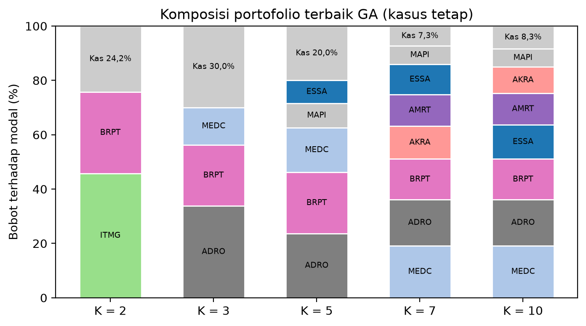
Gambar 4.2.1 Komposisi bobot saham dan kas GA pada setiap K

### 4.2.2 Analisis karakteristik pencarian (crossover dan mutasi) pada GA

Ablasi operator pada kasus tetap, parameter terpilih, 30 seed: tiap varian mematikan satu operator.

Tabel 4.2.3 Pengaruh operator GA terhadap expected return

| K | Varian | Median R (%) | Std (pp) | R terbaik (%) |
|---|---|---|---|---|
| 7 | Lengkap (parameter terpilih) | 33,78 | 0,15 | 34,13 |
| 7 | Tanpa pindah silang (SBX) | 33,76 | 0,15 | 33,97 |
| 7 | Tanpa mutasi Gaussian | 33,19 | 0,28 | 33,68 |
| 7 | Tanpa mutasi tukar kunci | 33,60 | 0,20 | 33,84 |
| 7 | Tanpa kedua mutasi | 33,05 | 0,28 | 33,68 |
| 10 | Lengkap (parameter terpilih) | 33,30 | 0,79 | 34,09 |
| 10 | Tanpa pindah silang (SBX) | 33,23 | 0,91 | 33,88 |
| 10 | Tanpa mutasi Gaussian | 29,40 | 0,93 | 30,91 |
| 10 | Tanpa mutasi tukar kunci | 33,05 | 0,98 | 33,72 |
| 10 | Tanpa kedua mutasi | 28,98 | 0,96 | 30,71 |

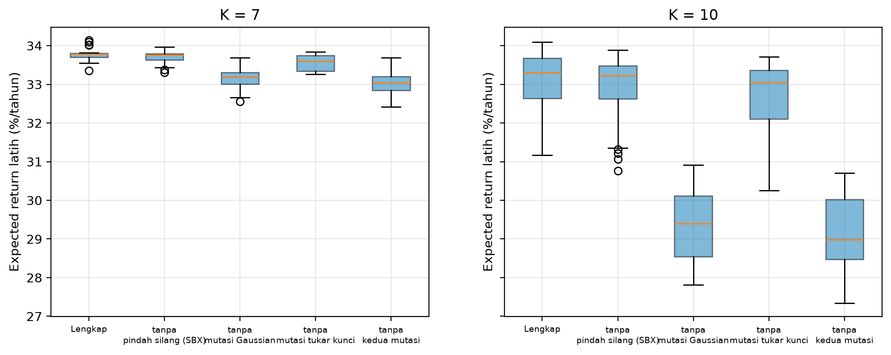
Gambar 4.2.2 Sebaran R GA tanpa operator tertentu

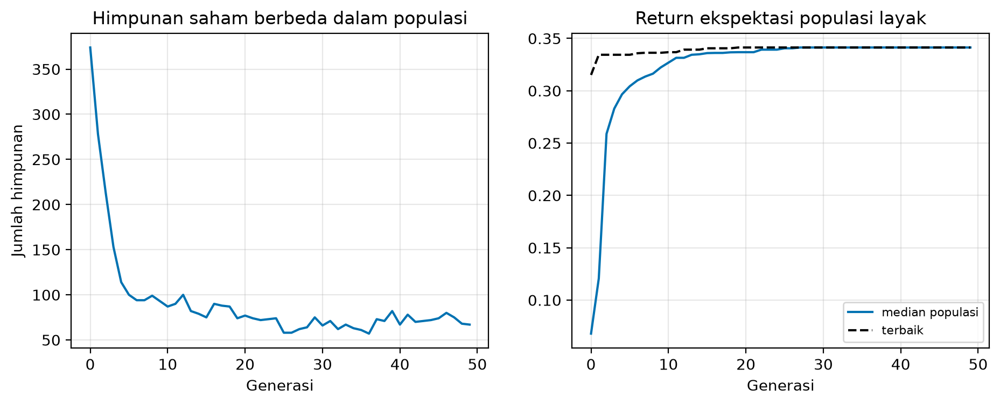
Gambar 4.2.3 Keragaman dan kualitas populasi GA tiap generasi (K = 7, seed terbaik)

### 4.2.3 (tambahan) Analisis konvergensi dan konsistensi hasil

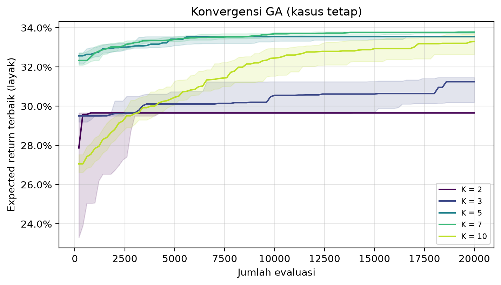
Gambar 4.2.4 Konvergensi GA pada setiap K

Tabel 4.2.4 Kinerja GA pada 30 percobaan (kasus tetap)

| K | Median R (%/tahun) | Simpangan baku (pp) | Kelayakan (%) | Median waktu (dtk) | Keberhasilan gap <= 1% (%) |
|---|---|---|---|---|---|
| 2 | 29,66 | 0,05 | 100,00 | 0,26 | 100,00 |
| 3 | 31,25 | 0,87 | 100,00 | 0,26 | 16,67 |
| 5 | 33,55 | 0,20 | 100,00 | 0,27 | 3,33 |
| 7 | 33,78 | 0,15 | 100,00 | 0,35 | 46,67 |
| 10 | 33,30 | 0,79 | 100,00 | 0,35 | 10,00 |

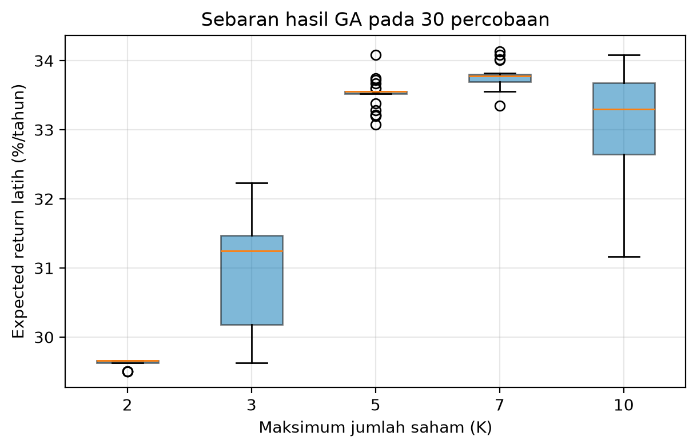
Gambar 4.2.5 Sebaran expected return GA pada 30 percobaan

Tabel 4.2.5 Verifikasi GA terhadap brute force pada K = 2 (semua periode data)

| Periode data | Optimum brute force (%) | R terbaik (%) | Median R (%) | Keberhasilan gap <= 1% (%) | Menemukan optimum (% run) |
|---|---|---|---|---|---|
| kasus_tetap | 29,66 | 29,66 | 29,66 | 100,00 | 63,33 |
| jendela_1 | 33,98 | 33,98 | 33,68 | 53,33 | 43,33 |
| jendela_2 | 32,93 | 32,93 | 30,92 | 16,67 | 16,67 |
| jendela_3 | 28,17 | 28,17 | 28,17 | 96,67 | 96,67 |
| jendela_4 | 39,59 | 39,59 | 39,59 | 53,33 | 53,33 |
| jendela_5 | 51,14 | 51,14 | 51,14 | 100,00 | 86,67 |

### 4.2.4 (tambahan) Evaluasi kinerja portofolio pada data uji

Tabel 4.2.6 Hasil evaluasi portofolio GA pada data uji (1 Okt 2025 - 30 Sep 2026, beli-dan-tahan)

| K | Return uji (%/tahun) | Volatilitas (%/tahun) | Max drawdown (%) | Nilai akhir (Rp) |
|---|---|---|---|---|
| 2 | -9,67 | 23,36 | -20,53 | Rp 4.541.291 |
| 3 | 10,09 | 24,64 | -16,14 | Rp 5.478.374 |
| 5 | 5,72 | 25,30 | -17,80 | Rp 5.271.286 |
| 7 | 4,47 | 26,37 | -21,45 | Rp 5.211.997 |
| 10 | 3,64 | 26,41 | -21,46 | Rp 5.172.536 |

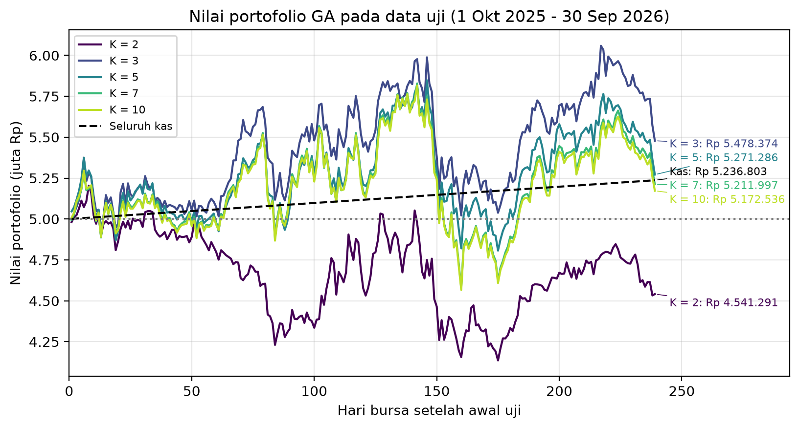
Gambar 4.2.6 Perkembangan nilai portofolio GA pada data uji

Tabel 4.2.7 Median return uji setara tahunan (%) pada walk-forward jendela 1-5

| K | Jendela 1 | Jendela 2 | Jendela 3 | Jendela 4 | Jendela 5 |
|---|---|---|---|---|---|
| 2 | 10,63 | -14,66 | 0,72 | -0,24 | -39,67 |
| 3 | -0,01 | -16,83 | -3,75 | 22,70 | -33,32 |
| 5 | 4,93 | -12,06 | -14,83 | 12,64 | -18,96 |
| 7 | 16,91 | -13,64 | 20,93 | 31,22 | -13,58 |
| 10 | 22,24 | -15,65 | 31,19 | 28,18 | -12,62 |

## 4.3 Hasil PSO

### 4.3.1 Optimasi alokasi dana portofolio

Tabel 4.3.1 Hasil optimasi terbaik PSO pada setiap K (batas risiko 23,90%/tahun)

| K | Seed | Jumlah saham | Dana saham (Rp) | Sisa kas (Rp) | Expected return (%/tahun) | Risiko (%/tahun) |
|---|---|---|---|---|---|---|
| 2 | 0 | 2 | Rp 3.787.500 | Rp 1.212.500 | 29,66 | 23,77 |
| 3 | 0 | 3 | Rp 3.500.000 | Rp 1.500.000 | 32,23 | 23,85 |
| 5 | 6 | 5 | Rp 4.000.000 | Rp 1.000.000 | 34,08 | 23,87 |
| 7 | 1 | 7 | Rp 4.635.500 | Rp 364.500 | 34,13 | 23,88 |
| 10 | 0 | 7 | Rp 4.635.500 | Rp 364.500 | 34,13 | 23,88 |

Portofolio dengan expected return tertinggi: K = 7 (seed 1), 34,13%/tahun.

Tabel 4.3.2 Rincian alokasi dana portofolio terbaik PSO (K = 7)

| Saham | Jumlah lot | Biaya pembelian (Rp) | Bobot (%) | Kontribusi return (pp) |
|---|---|---|---|---|
| MEDC | 7 | Rp 959.000 | 19,18 | 8,19 |
| ADRO | 5 | Rp 845.000 | 16,90 | 6,52 |
| BRPT | 2 | Rp 750.000 | 15,00 | 7,90 |
| AKRA | 5 | Rp 605.000 | 12,10 | 3,21 |
| AMRT | 3 | Rp 579.000 | 11,58 | 2,23 |
| ESSA | 8 | Rp 560.000 | 11,20 | 4,35 |
| MAPI | 3 | Rp 337.500 | 6,75 | 1,37 |

Total saham Rp 4.635.500 (92,71%); sisa kas Rp 364.500 (7,29%).

Gambar 4.3.1 Komposisi bobot saham dan kas PSO pada setiap K

### 4.3.2 Analisis konvergensi dan konsistensi hasil

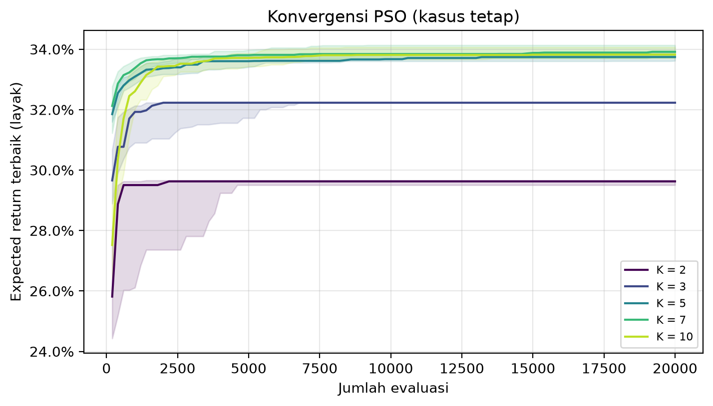
Gambar 4.3.2 Konvergensi PSO pada setiap K

Tabel 4.3.3 Kinerja PSO pada 30 percobaan (kasus tetap)

| K | Median R (%/tahun) | Simpangan baku (pp) | Kelayakan (%) | Median waktu (dtk) | Keberhasilan gap <= 1% (%) |
|---|---|---|---|---|---|
| 2 | 29,63 | 1,55 | 100,00 | 0,29 | 80,00 |
| 3 | 32,23 | 0,50 | 100,00 | 0,29 | 76,67 |
| 5 | 33,74 | 0,31 | 100,00 | 0,28 | 46,67 |
| 7 | 33,91 | 0,21 | 100,00 | 0,35 | 73,33 |
| 10 | 33,82 | 0,23 | 100,00 | 0,34 | 63,33 |

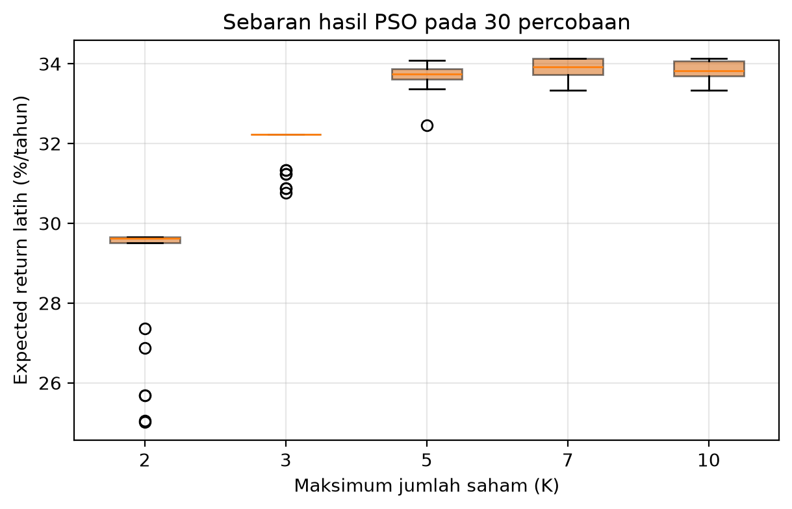
Gambar 4.3.3 Sebaran expected return PSO pada 30 percobaan

Tabel 4.3.4 Verifikasi PSO terhadap brute force pada K = 2 (semua periode data)

| Periode data | Optimum brute force (%) | R terbaik (%) | Median R (%) | Keberhasilan gap <= 1% (%) | Menemukan optimum (% run) |
|---|---|---|---|---|---|
| kasus_tetap | 29,66 | 29,66 | 29,63 | 80,00 | 43,33 |
| jendela_1 | 33,98 | 33,98 | 33,98 | 73,33 | 70,00 |
| jendela_2 | 32,93 | 32,93 | 30,92 | 46,67 | 46,67 |
| jendela_3 | 28,17 | 28,17 | 28,17 | 66,67 | 66,67 |
| jendela_4 | 39,59 | 39,59 | 38,96 | 30,00 | 30,00 |
| jendela_5 | 51,14 | 51,14 | 51,14 | 100,00 | 73,33 |

### 4.3.3 Evaluasi kinerja portofolio pada data uji

Tabel 4.3.5 Hasil evaluasi portofolio PSO pada data uji (1 Okt 2025 - 30 Sep 2026, beli-dan-tahan)

| K | Return uji (%/tahun) | Volatilitas (%/tahun) | Max drawdown (%) | Nilai akhir (Rp) |
|---|---|---|---|---|
| 2 | -9,67 | 23,36 | -20,53 | Rp 4.541.291 |
| 3 | 10,09 | 24,64 | -16,14 | Rp 5.478.374 |
| 5 | 5,72 | 25,30 | -17,80 | Rp 5.271.286 |
| 7 | 4,47 | 26,37 | -21,45 | Rp 5.211.997 |
| 10 | 4,47 | 26,37 | -21,45 | Rp 5.211.997 |

Gambar 4.3.4 Perkembangan nilai portofolio PSO pada data uji

Tabel 4.3.6 Median return uji setara tahunan (%) pada walk-forward jendela 1-5

| K | Jendela 1 | Jendela 2 | Jendela 3 | Jendela 4 | Jendela 5 |
|---|---|---|---|---|---|
| 2 | 5,05 | -12,79 | 0,72 | -0,24 | -39,67 |
| 3 | -0,78 | -16,83 | -3,19 | -6,62 | -33,32 |
| 5 | 4,27 | -12,06 | -14,83 | 14,53 | -33,32 |
| 7 | 12,42 | -14,38 | 6,85 | 20,75 | -12,78 |
| 10 | 12,42 | -14,25 | 6,85 | 20,75 | -12,21 |

## 4.4 Hasil SA

### 4.4.1 Optimasi alokasi dana portofolio

Tabel 4.4.1 Hasil optimasi terbaik SA pada setiap K (batas risiko 23,90%/tahun)

| K | Seed | Jumlah saham | Dana saham (Rp) | Sisa kas (Rp) | Expected return (%/tahun) | Risiko (%/tahun) |
|---|---|---|---|---|---|---|
| 2 | 0 | 2 | Rp 3.787.500 | Rp 1.212.500 | 29,66 | 23,77 |
| 3 | 1 | 3 | Rp 3.500.000 | Rp 1.500.000 | 32,23 | 23,85 |
| 5 | 8 | 5 | Rp 4.000.000 | Rp 1.000.000 | 34,08 | 23,87 |
| 7 | 6 | 7 | Rp 4.635.500 | Rp 364.500 | 34,13 | 23,88 |
| 10 | 1 | 7 | Rp 4.635.500 | Rp 364.500 | 34,13 | 23,88 |

Portofolio dengan expected return tertinggi: K = 7 (seed 6), 34,13%/tahun.

Tabel 4.4.2 Rincian alokasi dana portofolio terbaik SA (K = 7)

| Saham | Jumlah lot | Biaya pembelian (Rp) | Bobot (%) | Kontribusi return (pp) |
|---|---|---|---|---|
| MEDC | 7 | Rp 959.000 | 19,18 | 8,19 |
| ADRO | 5 | Rp 845.000 | 16,90 | 6,52 |
| BRPT | 2 | Rp 750.000 | 15,00 | 7,90 |
| AKRA | 5 | Rp 605.000 | 12,10 | 3,21 |
| AMRT | 3 | Rp 579.000 | 11,58 | 2,23 |
| ESSA | 8 | Rp 560.000 | 11,20 | 4,35 |
| MAPI | 3 | Rp 337.500 | 6,75 | 1,37 |

Total saham Rp 4.635.500 (92,71%); sisa kas Rp 364.500 (7,29%).

Gambar 4.4.1 Komposisi bobot saham dan kas SA pada setiap K

### 4.4.2 Analisis efisiensi penurunan suhu (cooling schedule) terhadap konvergensi

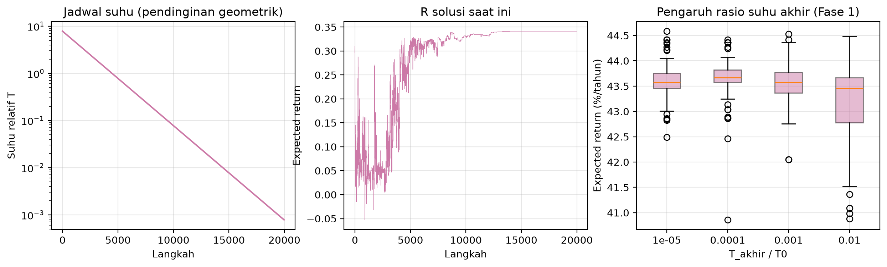
Gambar 4.4.2 Jadwal suhu, lintasan R, dan pengaruh rasio suhu akhir

Tabel 4.4.3 Median R (%/tahun) pada penalaan SA (jendela 1, K = 7, 30 seed per sel)

| Peluang penerimaan awal | T_akhir/T0 = 1e-05 | T_akhir/T0 = 0.0001 | T_akhir/T0 = 0.001 | T_akhir/T0 = 0.01 |
|---|---|---|---|---|
| 0,50 | 43,66 | 43,58 | 43,66 | 43,58 |
| 0,80 | 43,58 | 43,70 | 43,58 | 43,53 |
| 0,95 | 43,58 | 43,62 | 43,58 | 42,41 |

### 4.4.3 (tambahan) Analisis konvergensi dan konsistensi hasil

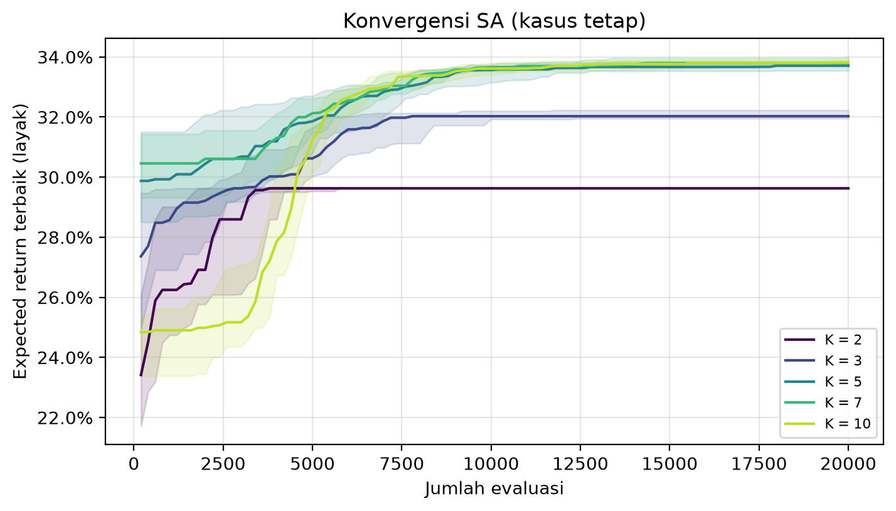
Gambar 4.4.3 Konvergensi SA pada setiap K

Tabel 4.4.4 Kinerja SA pada 30 percobaan (kasus tetap)

| K | Median R (%/tahun) | Simpangan baku (pp) | Kelayakan (%) | Median waktu (dtk) | Keberhasilan gap <= 1% (%) |
|---|---|---|---|---|---|
| 2 | 29,63 | 0,05 | 100,00 | 4,54 | 100,00 |
| 3 | 32,03 | 0,52 | 100,00 | 3,93 | 83,33 |
| 5 | 33,71 | 0,52 | 100,00 | 4,65 | 36,67 |
| 7 | 33,80 | 0,22 | 100,00 | 5,60 | 50,00 |
| 10 | 33,82 | 0,16 | 100,00 | 4,98 | 53,33 |

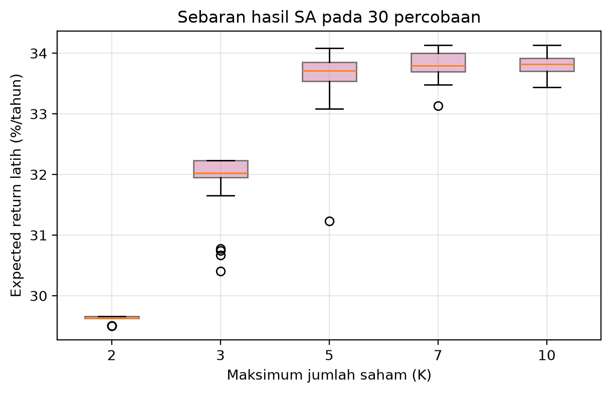
Gambar 4.4.4 Sebaran expected return SA pada 30 percobaan

Tabel 4.4.5 Verifikasi SA terhadap brute force pada K = 2 (semua periode data)

| Periode data | Optimum brute force (%) | R terbaik (%) | Median R (%) | Keberhasilan gap <= 1% (%) | Menemukan optimum (% run) |
|---|---|---|---|---|---|
| kasus_tetap | 29,66 | 29,66 | 29,63 | 100,00 | 36,67 |
| jendela_1 | 33,98 | 33,98 | 33,98 | 83,33 | 66,67 |
| jendela_2 | 32,93 | 32,93 | 32,41 | 43,33 | 43,33 |
| jendela_3 | 28,17 | 28,17 | 28,17 | 76,67 | 76,67 |
| jendela_4 | 39,59 | 39,59 | 39,59 | 56,67 | 56,67 |
| jendela_5 | 51,14 | 51,14 | 51,14 | 90,00 | 56,67 |

### 4.4.4 (tambahan) Evaluasi kinerja portofolio pada data uji

Tabel 4.4.6 Hasil evaluasi portofolio SA pada data uji (1 Okt 2025 - 30 Sep 2026, beli-dan-tahan)

| K | Return uji (%/tahun) | Volatilitas (%/tahun) | Max drawdown (%) | Nilai akhir (Rp) |
|---|---|---|---|---|
| 2 | -9,67 | 23,36 | -20,53 | Rp 4.541.291 |
| 3 | 10,09 | 24,64 | -16,14 | Rp 5.478.374 |
| 5 | 5,72 | 25,30 | -17,80 | Rp 5.271.286 |
| 7 | 4,47 | 26,37 | -21,45 | Rp 5.211.997 |
| 10 | 4,47 | 26,37 | -21,45 | Rp 5.211.997 |

Gambar 4.4.5 Perkembangan nilai portofolio SA pada data uji

Tabel 4.4.7 Median return uji setara tahunan (%) pada walk-forward jendela 1-5

| K | Jendela 1 | Jendela 2 | Jendela 3 | Jendela 4 | Jendela 5 |
|---|---|---|---|---|---|
| 2 | 5,05 | -12,79 | 0,72 | -0,24 | -39,67 |
| 3 | -4,07 | -16,83 | -3,19 | -6,62 | -33,32 |
| 5 | 4,98 | -10,30 | -15,51 | 10,68 | -33,32 |
| 7 | 15,42 | -11,75 | 6,85 | 21,73 | -13,12 |
| 10 | 15,33 | -14,09 | 13,61 | 21,77 | -12,89 |

## 4.5 Hasil DE

### 4.5.1 Optimasi alokasi dana portofolio

Tabel 4.5.1 Hasil optimasi terbaik DE pada setiap K (batas risiko 23,90%/tahun)

| K | Seed | Jumlah saham | Dana saham (Rp) | Sisa kas (Rp) | Expected return (%/tahun) | Risiko (%/tahun) |
|---|---|---|---|---|---|---|
| 2 | 0 | 2 | Rp 3.787.500 | Rp 1.212.500 | 29,66 | 23,77 |
| 3 | 0 | 3 | Rp 3.500.000 | Rp 1.500.000 | 32,23 | 23,85 |
| 5 | 2 | 5 | Rp 4.000.000 | Rp 1.000.000 | 34,08 | 23,87 |
| 7 | 2 | 7 | Rp 4.635.500 | Rp 364.500 | 34,13 | 23,88 |
| 10 | 0 | 7 | Rp 4.635.500 | Rp 364.500 | 34,13 | 23,88 |

Portofolio dengan expected return tertinggi: K = 7 (seed 2), 34,13%/tahun.

Tabel 4.5.2 Rincian alokasi dana portofolio terbaik DE (K = 7)

| Saham | Jumlah lot | Biaya pembelian (Rp) | Bobot (%) | Kontribusi return (pp) |
|---|---|---|---|---|
| MEDC | 7 | Rp 959.000 | 19,18 | 8,19 |
| ADRO | 5 | Rp 845.000 | 16,90 | 6,52 |
| BRPT | 2 | Rp 750.000 | 15,00 | 7,90 |
| AKRA | 5 | Rp 605.000 | 12,10 | 3,21 |
| AMRT | 3 | Rp 579.000 | 11,58 | 2,23 |
| ESSA | 8 | Rp 560.000 | 11,20 | 4,35 |
| MAPI | 3 | Rp 337.500 | 6,75 | 1,37 |

Total saham Rp 4.635.500 (92,71%); sisa kas Rp 364.500 (7,29%).

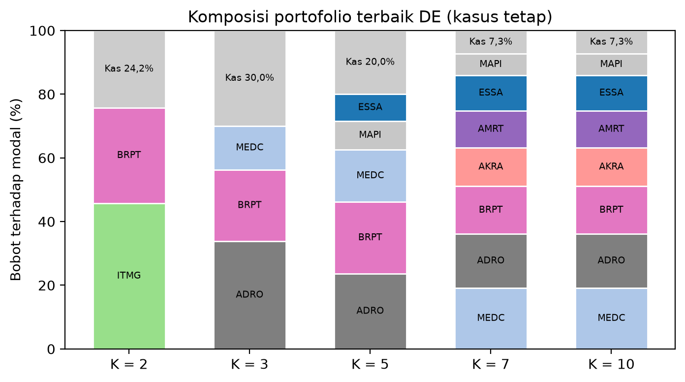
Gambar 4.5.1 Komposisi bobot saham dan kas DE pada setiap K

### 4.5.2 Analisis konvergensi dan konsistensi hasil

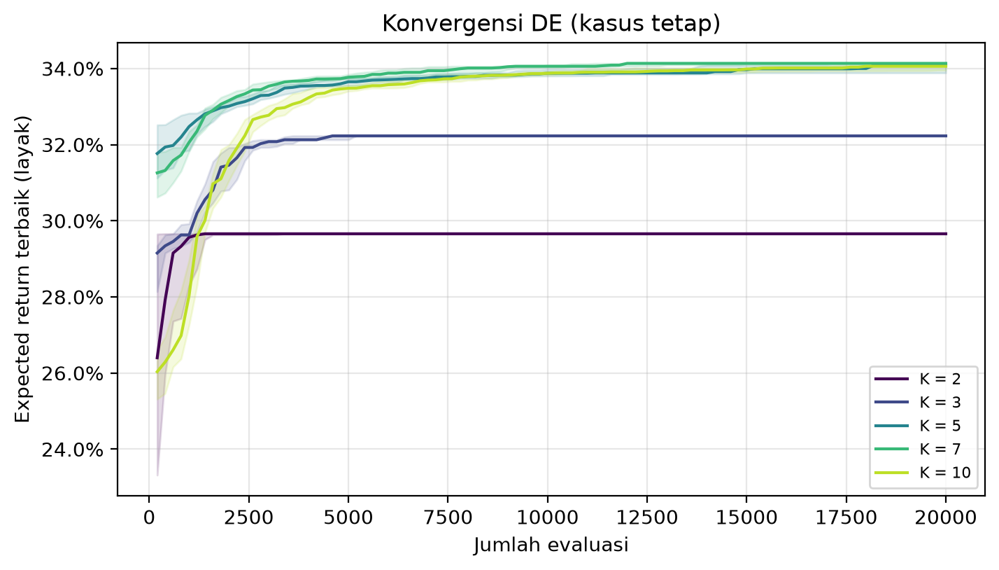
Gambar 4.5.2 Konvergensi DE pada setiap K

Tabel 4.5.3 Kinerja DE pada 30 percobaan (kasus tetap)

| K | Median R (%/tahun) | Simpangan baku (pp) | Kelayakan (%) | Median waktu (dtk) | Keberhasilan gap <= 1% (%) |
|---|---|---|---|---|---|
| 2 | 29,66 | 0,01 | 100,00 | 0,34 | 100,00 |
| 3 | 32,23 | 0,00 | 100,00 | 0,36 | 100,00 |
| 5 | 34,08 | 0,12 | 100,00 | 0,38 | 96,67 |
| 7 | 34,13 | 0,05 | 100,00 | 0,34 | 100,00 |
| 10 | 34,06 | 0,08 | 100,00 | 0,41 | 100,00 |

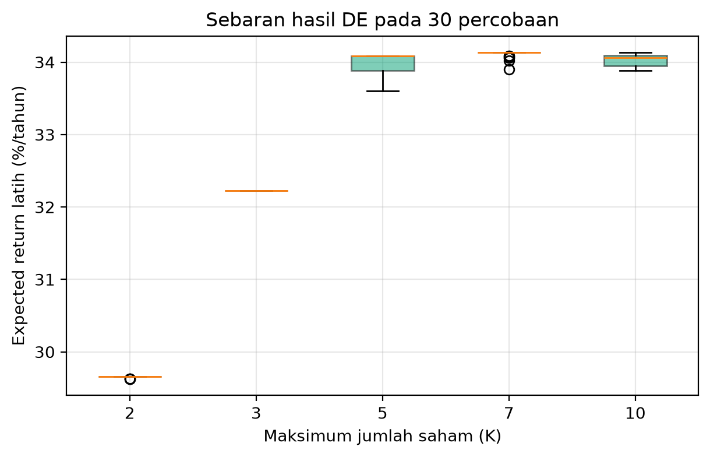
Gambar 4.5.3 Sebaran expected return DE pada 30 percobaan

Tabel 4.5.4 Verifikasi DE terhadap brute force pada K = 2 (semua periode data)

| Periode data | Optimum brute force (%) | R terbaik (%) | Median R (%) | Keberhasilan gap <= 1% (%) | Menemukan optimum (% run) |
|---|---|---|---|---|---|
| kasus_tetap | 29,66 | 29,66 | 29,66 | 100,00 | 86,67 |
| jendela_1 | 33,98 | 33,98 | 33,98 | 100,00 | 100,00 |
| jendela_2 | 32,93 | 32,93 | 32,93 | 96,67 | 96,67 |
| jendela_3 | 28,17 | 28,17 | 28,17 | 100,00 | 100,00 |
| jendela_4 | 39,59 | 39,59 | 39,59 | 100,00 | 100,00 |
| jendela_5 | 51,14 | 51,14 | 51,14 | 100,00 | 100,00 |

### 4.5.3 Evaluasi kinerja portofolio pada data uji

Tabel 4.5.5 Hasil evaluasi portofolio DE pada data uji (1 Okt 2025 - 30 Sep 2026, beli-dan-tahan)

| K | Return uji (%/tahun) | Volatilitas (%/tahun) | Max drawdown (%) | Nilai akhir (Rp) |
|---|---|---|---|---|
| 2 | -9,67 | 23,36 | -20,53 | Rp 4.541.291 |
| 3 | 10,09 | 24,64 | -16,14 | Rp 5.478.374 |
| 5 | 5,72 | 25,30 | -17,80 | Rp 5.271.286 |
| 7 | 4,47 | 26,37 | -21,45 | Rp 5.211.997 |
| 10 | 4,47 | 26,37 | -21,45 | Rp 5.211.997 |

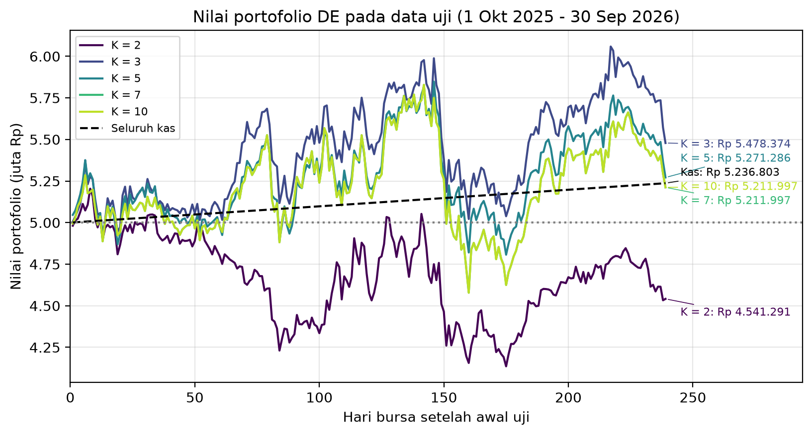
Gambar 4.5.4 Perkembangan nilai portofolio DE pada data uji

Tabel 4.5.6 Median return uji setara tahunan (%) pada walk-forward jendela 1-5

| K | Jendela 1 | Jendela 2 | Jendela 3 | Jendela 4 | Jendela 5 |
|---|---|---|---|---|---|
| 2 | 5,05 | -12,79 | 0,72 | -0,24 | -39,67 |
| 3 | -0,78 | -16,83 | -3,19 | -6,62 | -33,32 |
| 5 | 4,50 | -12,06 | -14,83 | 14,53 | -33,32 |
| 7 | 10,01 | -12,25 | 13,99 | 20,75 | -13,28 |
| 10 | 10,46 | -13,93 | 14,17 | 23,18 | -12,78 |

### 4.5.4 Sensitivitas parameter F dan CR (tambahan)

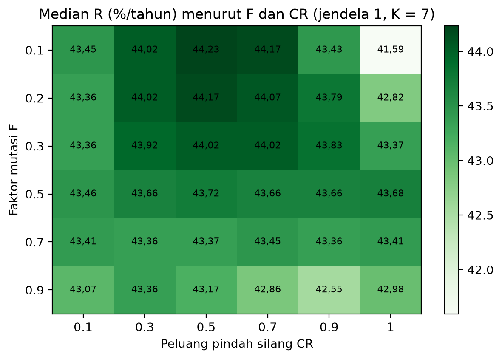
Gambar 4.5.5 Median R menurut F dan CR pada penalaan DE

## 4.6 Komparasi dan diskusi lintas algoritma

### 4.6.1 Perbandingan kinerja portofolio optimal

Tabel 4.6.1 Expected return, risiko, dan Sharpe ratio portofolio terbaik per algoritma (kasus tetap)

| K | Algoritma | R terbaik (%) | Median R (%) | Risiko (%) | Sharpe latih | Return uji (%) | Volatilitas uji (%) | Sharpe uji |
|---|---|---|---|---|---|---|---|---|
| 2 | GA | 29,66 | 29,66 | 23,77 | 1,04 | -9,67 | 23,36 | -0,63 |
| 2 | PSO | 29,66 | 29,63 | 23,77 | 1,04 | -9,67 | 23,36 | -0,63 |
| 2 | SA | 29,66 | 29,63 | 23,77 | 1,04 | -9,67 | 23,36 | -0,63 |
| 2 | DE | 29,66 | 29,66 | 23,77 | 1,04 | -9,67 | 23,36 | -0,63 |
| 3 | GA | 32,23 | 31,25 | 23,85 | 1,14 | 10,09 | 24,64 | 0,21 |
| 3 | PSO | 32,23 | 32,23 | 23,85 | 1,14 | 10,09 | 24,64 | 0,21 |
| 3 | SA | 32,23 | 32,03 | 23,85 | 1,14 | 10,09 | 24,64 | 0,21 |
| 3 | DE | 32,23 | 32,23 | 23,85 | 1,14 | 10,09 | 24,64 | 0,21 |
| 5 | GA | 34,08 | 33,55 | 23,87 | 1,22 | 5,72 | 25,30 | 0,03 |
| 5 | PSO | 34,08 | 33,74 | 23,87 | 1,22 | 5,72 | 25,30 | 0,03 |
| 5 | SA | 34,08 | 33,71 | 23,87 | 1,22 | 5,72 | 25,30 | 0,03 |
| 5 | DE | 34,08 | 34,08 | 23,87 | 1,22 | 5,72 | 25,30 | 0,03 |
| 7 | GA | 34,13 | 33,78 | 23,88 | 1,22 | 4,47 | 26,37 | -0,02 |
| 7 | PSO | 34,13 | 33,91 | 23,88 | 1,22 | 4,47 | 26,37 | -0,02 |
| 7 | SA | 34,13 | 33,80 | 23,88 | 1,22 | 4,47 | 26,37 | -0,02 |
| 7 | DE | 34,13 | 34,13 | 23,88 | 1,22 | 4,47 | 26,37 | -0,02 |
| 10 | GA | 34,09 | 33,30 | 23,88 | 1,22 | 3,64 | 26,41 | -0,05 |
| 10 | PSO | 34,13 | 33,82 | 23,88 | 1,22 | 4,47 | 26,37 | -0,02 |
| 10 | SA | 34,13 | 33,82 | 23,88 | 1,22 | 4,47 | 26,37 | -0,02 |
| 10 | DE | 34,13 | 34,06 | 23,88 | 1,22 | 4,47 | 26,37 | -0,02 |

Sharpe latih = (R - r_f) / sigma; Sharpe uji = (return setara tahunan uji - r_f) / volatilitas uji.

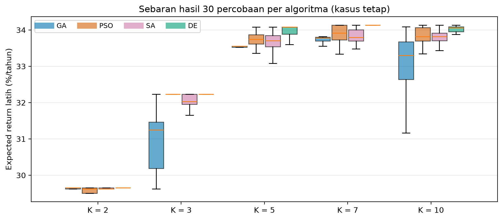
Gambar 4.6.1 Sebaran expected return empat algoritma pada setiap K

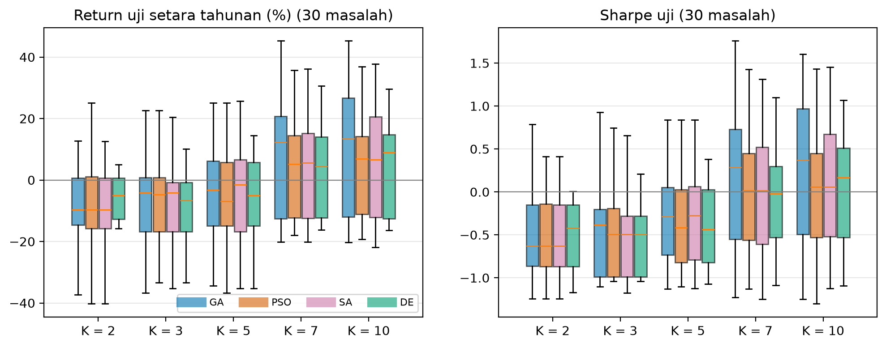
Gambar 4.6.2 Return dan Sharpe uji pada 30 masalah

### 4.6.2 Perbandingan kecepatan komputasi dan stabilitas konvergensi

Tabel 4.6.2 Komputasi dan stabilitas (seluruh 30 masalah)

| Algoritma | Median waktu (dtk) | Median evaluasi hingga terbaik | Terbaik sebelum 50% anggaran (%) | Std R rata-rata antar seed (pp) | Keberhasilan gap <= 1% (%) | Peringkat rata-rata |
|---|---|---|---|---|---|---|
| GA | 0,31 | 9620,50 | 51,00 | 0,58 | 37,00 | 3,47 |
| PSO | 0,29 | 3344,50 | 79,22 | 0,74 | 58,22 | 2,15 |
| SA | 4,48 | 8874,00 | 59,89 | 0,54 | 51,33 | 2,78 |
| DE | 0,35 | 7745,50 | 56,67 | 0,12 | 79,67 | 1,60 |

Tabel 4.6.3 Uji Wilcoxon berpasangan atas 30 masalah dengan koreksi Holm

| A | B | median_selisih | menang_A | menang_B | seri | p | p_holm | signifikan |
|---|---|---|---|---|---|---|---|---|
| DE | GA | 0,531 pp | 24 | 0 | 6 | 0,0000 | 0,0001 | ya |
| GA | PSO | -0,397 pp | 3 | 22 | 5 | 0,0001 | 0,0006 | ya |
| DE | SA | 0,182 pp | 22 | 2 | 6 | 0,0002 | 0,0008 | ya |
| GA | SA | -0,355 pp | 6 | 21 | 3 | 0,0005 | 0,0016 | ya |
| DE | PSO | 0,000 pp | 14 | 4 | 12 | 0,0084 | 0,0168 | ya |
| PSO | SA | 0,051 pp | 17 | 5 | 8 | 0,1831 | 0,1831 | tidak |

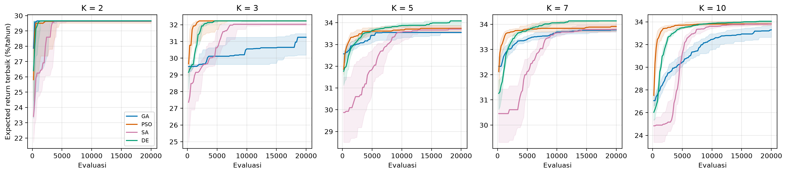
Gambar 4.6.3 Konvergensi gabungan pada setiap K (profil 1,5x)

### 4.6.3 Analisis konvergensi gabungan

Profil risiko menentukan batas sigma_max: Konservatif 1,5x, Moderat 2,0x, Agresif 2,5x volatilitas portofolio 1/N (kasus tetap, 30 seed, parameter beku).

#### 4.6.3.1 Skenario profil risiko Konservatif

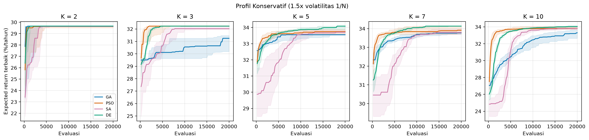
Gambar 4.6.4.1 Konvergensi gabungan profil Konservatif

Tabel 4.6.4.1 Median expected return (%/tahun) profil Konservatif

| K | DE | GA | PSO | SA |
|---|---|---|---|---|
| 2 | 29,66 | 29,66 | 29,63 | 29,63 |
| 3 | 32,23 | 31,25 | 32,23 | 32,03 |
| 5 | 34,08 | 33,55 | 33,74 | 33,71 |
| 7 | 34,13 | 33,78 | 33,91 | 33,80 |
| 10 | 34,06 | 33,30 | 33,82 | 33,82 |

#### 4.6.3.2 Skenario profil risiko Moderat

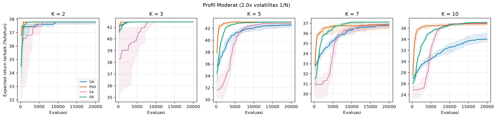
Gambar 4.6.4.2 Konvergensi gabungan profil Moderat

Tabel 4.6.4.2 Median expected return (%/tahun) profil Moderat

| K | DE | GA | PSO | SA |
|---|---|---|---|---|
| 2 | 37,79 | 37,79 | 37,79 | 37,79 |
| 3 | 41,44 | 41,44 | 41,44 | 41,44 |
| 5 | 43,07 | 42,57 | 43,07 | 42,83 |
| 7 | 37,13 | 36,84 | 36,86 | 36,75 |
| 10 | 37,10 | 34,03 | 36,80 | 36,91 |

#### 4.6.3.3 Skenario profil risiko Agresif

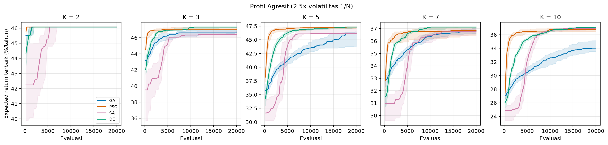
Gambar 4.6.4.3 Konvergensi gabungan profil Agresif

Tabel 4.6.4.3 Median expected return (%/tahun) profil Agresif

| K | DE | GA | PSO | SA |
|---|---|---|---|---|
| 2 | 46,07 | 46,07 | 46,07 | 46,07 |
| 3 | 47,33 | 46,60 | 47,05 | 46,40 |
| 5 | 47,33 | 46,07 | 47,33 | 46,18 |
| 7 | 37,13 | 36,84 | 36,86 | 36,75 |
| 10 | 37,10 | 34,03 | 36,80 | 36,91 |

Tabel 4.6.5 Persentase algoritma yang risikonya menempel pada batas (mengikat) per profil dan K

| profil | 2 | 3 | 5 | 7 | 10 |
|---|---|---|---|---|---|
| Agresif | 0 | 0 | 0 | 0 | 0 |
| Konservatif | 50 | 50 | 100 | 100 | 100 |
| Moderat | 100 | 100 | 100 | 0 | 0 |

Bila batas tidak mengikat, menaikkan batas risiko tidak menaikkan return, sehingga profil yang berbeda dapat memberi hasil identik.
